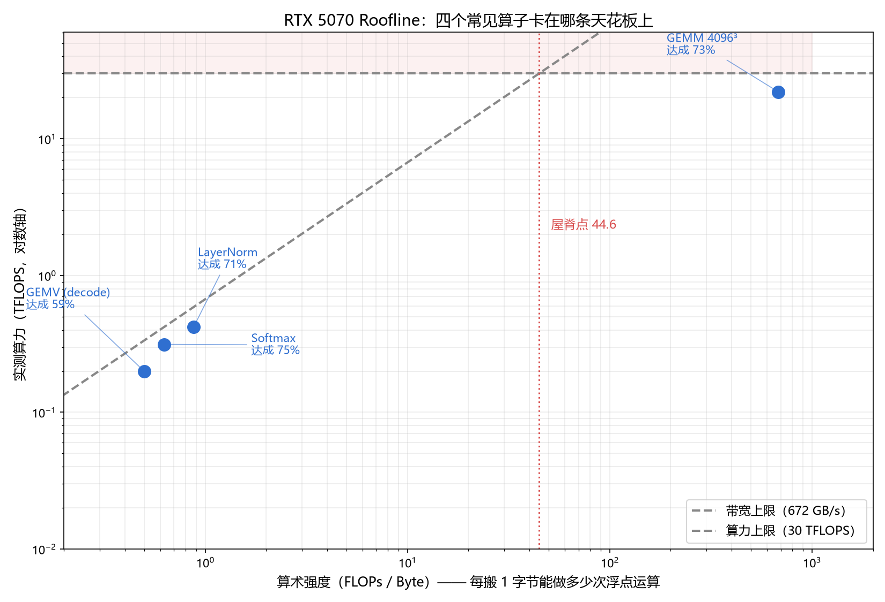

# 第 4 讲 · 算术强度与 Roofline

> W2 / L04 · 预计 30 min 理解 + 60–90 min 实操
> 通过标准：能手算一个算子的算术强度 + 能说出它该往哪个方向优化

---

## ① 依赖门（1 min）

**✅ 现在只需要补这些：**
1. 会算浮点运算量（矩阵乘的 `2MNK` 这种）
2. 知道"字节数"和"元素个数"差 4 倍（float32）
3. 会看对数坐标轴

**⏸️ 现在不学也没影响：**
缓存复用率怎么算、roofline 的扩展版本（cache-aware roofline）、屋顶模型的论文原推导 —— 全部不需要。

**🔜 什么时候会回来：**
- **L05（下一讲）**：用它解释"为什么 decode 一定慢"
- **W5–W6 做 SGEMM**：每次优化前先算一遍，确认自己没在优化天花板
- **W10 量化**：量化之所以有用，本质就是**把 Bytes 减半/减到 1/4**
- **面试**：这是最能分辨"真懂"和"背过"的一道题

---

## ② 直觉先行（6 min）

把 GPU 想成一个**工地**：

```
算力（FLOPS）  = 工人砌墙的速度        ← 一秒钟能砌多少块砖
带宽（GB/s）   = 卡车运砖的速度        ← 一秒钟能运多少块砖到工地
```

**算术强度 = 每运来 1 块砖，工人能砌几堵墙。**

| 场景 | 算术强度 | 谁在等谁 |
|---|---|---|
| 砖很少，墙很大（矩阵乘） | 高 | **卡车等工人** → 加人没用，要加卡车？不，是**工人已经满了** → 算力瓶颈 |
| 墙很小，砖很多（归一化） | 低 | **工人等卡车** → 加工人没用，要**多运砖** → 带宽瓶颈 |

**关键：这两种瓶颈的优化手段完全相反。**

- 算力瓶颈 → 想办法让工人砌得更快（Tensor Core、更好的分块）
- 带宽瓶颈 → 想办法**少运砖**（量化、算子融合、减少数据搬运）

> ⚠️ **选错方向 = 白干。** 一个带宽瓶颈的算子，你把算力提高 10 倍，性能一点不变。

---

## ③ 原理（8 min）

### 3.1 算术强度（Arithmetic Intensity）

```
算术强度 = FLOPs ÷ Bytes         单位：FLOPs / Byte
```

- **FLOPs**：这个算子要做多少次浮点运算（一次乘加算 2 次）
- **Bytes**：它**最少**要从显存搬多少字节

> "最少"很重要 —— 只算**必须访问**的那份数据。分块/缓存带来的复用不算在内，那是"可实现的下界"。

### 3.2 Roofline：两条天花板，一个交点

```
性能
(TFLOPS)
  30 ┤━━━━━━━━━━━━━━━━━━━━━━━━━━━━━━  ← 算力上限（水平线）
     │                        ╱
     │                      ╱    ← 带宽上限（斜线，斜率 = 带宽）
     │                    ╱
     │                  ╱
     │                ╱
     │              ╱
   0 └────────────╱──────────────────▶ 算术强度 (FLOPs/Byte)
                  ↑ 屋脊点 = 算力 ÷ 带宽
```

- **斜线左边**（算术强度低）→ 卡在**带宽**上。提高算力毫无用处。
- **斜线右边**（算术强度高）→ 卡在**算力**上。此时带宽不是问题。
- **交点 = 屋脊点（Ridge Point）** = `峰值算力 ÷ 峰值带宽`，是判断分界线

**本机（RTX 5070）的屋脊点：**

```
30 TFLOPS ÷ 672 GB/s = 44.6 FLOPs/Byte
```

> **算术强度 < 44.6 → 带宽瓶颈；> 44.6 → 算力瓶颈。**

### 3.3 手算四个算子（这一步必须自己推一遍）

#### GEMM：`n×n` 乘 `n×n`

```
运算量  2n³         每个输出元素做 n 次乘加，乘加各算 1 次浮点运算
搬运    3n² 个 float（读 A + 读 B + 写 C），即 12n² 字节
强度    2n³ / 12n² = n/6
```

**👉 算术强度随 n 线性增长。** n=4096 时强度 = 683。

#### GEMV：`m×n` 矩阵乘 `n` 维向量（**这就是 batch=1 的 decode**）

```
运算量  2mn
搬运    ≈ 4mn 字节（读矩阵占绝对多数，向量和输出可忽略）
强度    2mn / 4mn = 0.5
```

**👉 与尺寸完全无关，恒定 0.5。** 这是它和 GEMM 的本质区别。

#### Softmax：一行的 N 个元素

```
运算量  ≈ 5N    找最大值 N 次比较、减+exp 2N、求和 N、相除 N
搬运    8N 字节（读 N + 写 N，每个 float 4 字节）
强度    ≈ 0.625
```

#### LayerNorm：一行的 N 个元素

```
运算量  ≈ 7N    求均值 N、求方差 2N、归一化 2N、缩放平移 2N
搬运    8N 字节
强度    ≈ 0.875
```

> 📌 **这四个式子里藏着一件反直觉的事**：矩阵乘和归一化的差别，**根本不在"算法复杂度"**，而在"每搬一个字节能干多少次活"。

### 3.4 实测结果（本机）

```
RTX 5070 屋脊点 = 44.6 FLOPs/Byte

算子               算术强度   实测 TFLOPS   理论上限   达成率   瓶颈
-----------------------------------------------------------------
GEMM 4096³          683.0       22.0        30.0     73%    算力
GEMV (decode)         0.5        0.20        0.34     59%    带宽
Softmax               0.625      0.31        0.42     75%    带宽
LayerNorm             0.875      0.42        0.59     71%    带宽
```

### 🎯 这张表最值得记的一句话

> **GEMM 跑 22.0 TFLOPS，GEMV 跑 0.20 TFLOPS —— 同一块显卡、同一个 cuBLAS 库，差 110 倍。**
>
> 唯一的原因是**算术强度差了 1366 倍**（683 ÷ 0.5）。

这就是为什么：

| 场景 | 形态 | 瓶颈 | 优化方向 |
|---|---|---|---|
| **Prefill**（一次处理整个 prompt） | 大 GEMM | 算力 | Tensor Core、更好的分块、更大 batch |
| **Decode**（一次出一个 token） | GEMV | **带宽** | **量化**、算子融合、减少搬运 |

> 记住这个，第 5 讲整讲就是在展开它。

**顺带一个发现**：GEMV 的带宽达成率只有 **59%**（0.20 TFLOPS ÷ 0.5 = 400 GB/s，理论上限 672 GB/s）。
说明 **torch 内置的 GEMV 还没把带宽榨干**，还有 40% 空间 —— 这正是 vLLM / llama.cpp 里那些优化 kernel 在做的事。

---

## ④ 实操（12 min）

代码：[`code/l04_roofline.py`](code/l04_roofline.py)

```bash
bash ~/work/sync.sh
source ~/work/venv/bin/activate
cd ~/work
python l04_roofline.py          # 输出 l04_roofline.png
```

**核心代码：**

```python
import torch
import plot_style as ps

PEAK_TFLOPS = 30.0
PEAK_BW_GB = 672.0
RIDGE = PEAK_TFLOPS * 1e12 / (PEAK_BW_GB * 1e9)      # 44.6

def bench(fn, warmup=10, rep=50):                     # L02 的标准计时方法
    ...

N = 4096
A = torch.randn(N, N, device="cuda")
B = torch.randn(N, N, device="cuda")
v = torch.randn(N, device="cuda")

OPS = [
    ("GEMM 4096³",   2 * N ** 3, 4 * 3 * N * N, lambda: A @ B),
    ("GEMV (decode)", 2 * N * N, 4 * (N * N + N + N), lambda: A @ v),
    ("Softmax",       5 * N * N, 4 * 2 * N * N, lambda: torch.softmax(A, dim=-1)),
    ("LayerNorm",     7 * N * N, 4 * 2 * N * N, lambda: torch.nn.functional.layer_norm(A, (N,))),
]

for name, flops, bytes_, fn in OPS:
    ms = bench(fn)
    ai = flops / bytes_
    tf = flops / (ms / 1e3) / 1e12
    ceil = min(PEAK_TFLOPS, ai * PEAK_BW_GB / 1000)   # ← Roofline 的答案就在这一行
    bound = "算力" if ai > RIDGE else "带宽"
```

**渲染结果：** [`code/traces/l04_roofline.png`](code/traces/l04_roofline.png)



**怎么读这张图：**

| 现象 | 含义 |
|---|---|
| GEMM 的点跑到了**右上角**，紧贴水平线 | 算力瓶颈，已经用到 73% |
| 另外三个点挤在**左下角**，紧贴斜线 | 带宽瓶颈，它们**永远不可能跑到右上角** |
| 左下三个点**贴着斜线** | 说明它们已经把带宽用得差不多了，但还有余量 |
| 红色虚线（屋脊点 44.6）**把两类算子彻底分开** | 左边全是带宽瓶颈，右边只有 GEMM |

---

## ⑤ 语法与坑点（2 min）

| 语法 / 坑 | 说明 |
|---|---|
| **`A @ v`（2 维 @ 1 维）** | PyTorch 会走 `mv`（矩阵向量乘），不是 `mm`。这正是 decode 的形态 |
| **浮点运算量必须换算单位** | `2*N**3` 是运算**次数**；带宽要的是**字节数**，float32 记得 ×4 |
| **带宽算错的第一大原因** | 忘记乘 2（读 + 写）。L02 已经踩过一次 |
| **`ax.loglog()`** | 算术强度跨 4 个数量级（0.5 ~ 683），必须用对数轴，否则左下角挤成一团 |
| **`min(PEAK, AI × BW)`** | 理论上限永远取两者较小值 —— 这就是 Roofline 的全部数学，一行就够 |
| **softmax / layernorm 的 FLOPs 是估算** | 我按 5N / 7N 估的。它们对结论不敏感（AI 在 1 附近），但写报告时要说明是估算 |
| **`import plot_style as ps`** | 本讲新增的公共画图模块，中文字体设置都在里面。以后所有图都用它 |

---

## ⑥ 自测 3 题（1 min）

1. GEMM 的算术强度是 `n/6`，GEMV 是恒定 `0.5`。**为什么 GEMV 与尺寸无关，而 GEMM 随尺寸线性增长？** 提示：想想"每个字节被用了几次"。
2. 一个算子实测 8 TFLOPS，算术强度 10 FLOPs/Byte。**它是算力瓶颈还是带宽瓶颈？还有多少提升空间？**
3. 你要优化 LayerNorm（算术强度 0.875）。**下面哪些做法有用？** （多选）
   - A. 用 Tensor Core 加速矩阵部分
   - B. 把 `LayerNorm + 残差加 + 激活函数` 融合成一个 kernel
   - C. 用 FP16/BF16 存中间结果
   - D. 优化 shared memory 的 bank conflict
   - E. 增大 batch size

---

## ⑦ 下一讲预告

**L05 · 为什么 decode 一定是 memory-bound**

L04 你已经知道 GEMV 的算术强度是 0.5。下一讲把它**装进真实的 LLM**：
一个 7B 模型，batch=1 的 decode，每出一个 token 要读多少字节？
答案是：**把全部权重读一遍。**

然后你就能算出一个数 —— **理论延迟下限 = 权重字节数 ÷ 带宽**。
这个数会告诉你：为什么 12 GB 的 5070 跑 7B 模型，理论最快也就每秒几十个 token；以及**量化为什么能直接加速**。
